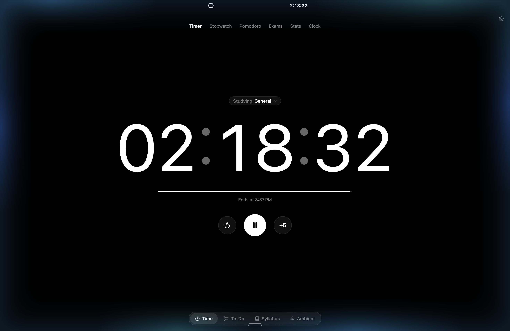
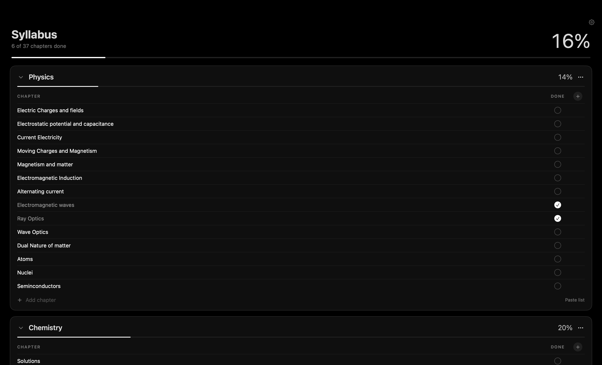
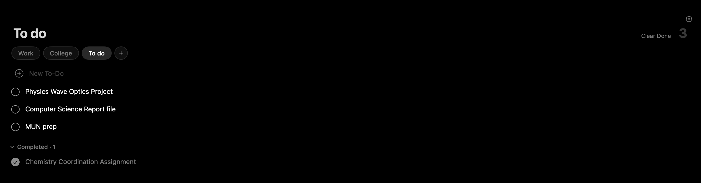
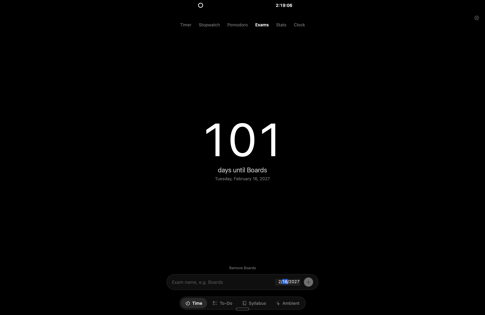
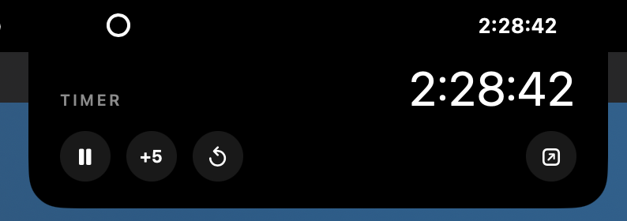

# Solace

**A free, minimalist study companion for Mac.**

[](https://github.com/aaditguglani01/solace/releases/latest/download/Solace.zip)
[](https://github.com/aaditguglani01/solace/releases)
[](https://github.com/aaditguglani01/solace/releases/latest)

Solace keeps a student's day in one calm, pitch-black window. You can plan your syllabus subject by subject and track every chapter and revision with live progress percentages. A timer, Pomodoro or stopwatch keeps you on task, and you can see how many days are left until your next exam. You can also keep separate to-do lists for school and everything else.

There are no accounts, no ads and no internet connection. Everything stays on your Mac.

*Designed and developed by **Aadit Guglani**. Built with AI-assisted development (Claude by Anthropic).*

<p align="center"><br><sub>Focus timer with the ambient glow on.</sub></p>

| Syllabus tracker | To-do lists |
|---|---|
|  |  |

| Exam countdown | Notch timer |
|---|---|
|  |  |

---

## Features

### ⏱ Time
- **Timer:** type any duration (click a number and type, use ↑ ↓, press Return to start), or pick a preset. While it runs, you can add 5 minutes at any point.
- **Pomodoro:** focus and break cycles with adjustable lengths, and the next phase can start automatically.
- **Stopwatch:** with laps; the fastest lap shows in green and the slowest in red.
- **Exams:** add *Boards*, *JEE*, *Pre-boards* or any exam with its date, and see **"89 days until Boards"** in big type.
- **Stats:** study time today, this week and all time, plus a 7-day chart and your daily streak. You can optionally tag sessions with a subject to see time per subject.
- **Clock**

### ✅ To-Do
- Multiple lists (for example *To Do*, *School*, *Personal*). Double-click a list to rename it.
- Ticked items slide down into a **Completed** section, so open tasks stay on top.

### 📚 Syllabus
- Add your own subjects and chapters. Nothing comes pre-loaded.
- Tick each chapter when it's done, then add **Revision 1, 2, 3…** columns per subject.
- Each subject shows a **percentage** and the top shows your **overall %**, weighted by number of chapters.
- To add many chapters at once, paste a whole list with one chapter per line.

### ✨ Ambient light
- A soft glow around the edges of your screen.
- **Music mode:** takes the main colour of the Apple Music album cover and pulses to the beat.
- **Color mode:** your own colours, drifting slowly.
- **Follow Pomodoro:** warm while you focus, green on breaks. The edges flash when a timer ends.

### 🔝 Notch timer
- The running timer sits next to the MacBook notch. Hover over it for pause, +5, skip and reset.

### ⌨️ Shortcuts
| Key | Action |
|---|---|
| Space | Start / pause (Time tab) |
| ⌘N | New to-do |
| ⌘1 – ⌘4 | Time · To-Do · Syllabus · Ambient |
| ⌘, | Settings |

---

## Download & install

**Requirements:** macOS 15 or newer and an Apple Silicon Mac (M1 or later).

1. Download **[Solace.zip](https://github.com/aaditguglani01/solace/releases/latest/download/Solace.zip)** (latest release).
2. Double-click it to unzip, then drag **Solace** into **Applications**.
3. Open Solace. macOS will say it can't verify the developer, because Solace is a free student project and isn't notarized by Apple. Click **Done**.
4. Go to **System Settings → Privacy & Security**, scroll down and click **Open Anyway**. You only need to do this once.

When asked, allow these optional permissions:
- **Apple Music control:** reads the song and album cover for the glow.
- **System Audio Recording:** measures loudness so the glow can pulse to the beat. Nothing is recorded or saved.
- **Notifications:** timer alerts.

## Privacy

Solace has no network code at all. Your lists, syllabus, exams and study time are stored as small files in `~/Library/Application Support/Solace` on your Mac. Use **File → Export Backup** to move them to another Mac.

## Build from source

Requires Apple's free Command Line Tools (`xcode-select --install`).

```bash
git clone https://github.com/aaditguglani01/solace.git
cd solace
./build.sh          # → build/Solace.app and build/Solace.zip
```

## Credits

Designed and developed by **Aadit Guglani**. The code was written with AI assistance (Claude by Anthropic).

## License

[MIT](LICENSE) © 2026 Aadit Guglani. You're free to use and modify Solace. Copies must keep the copyright notice.
